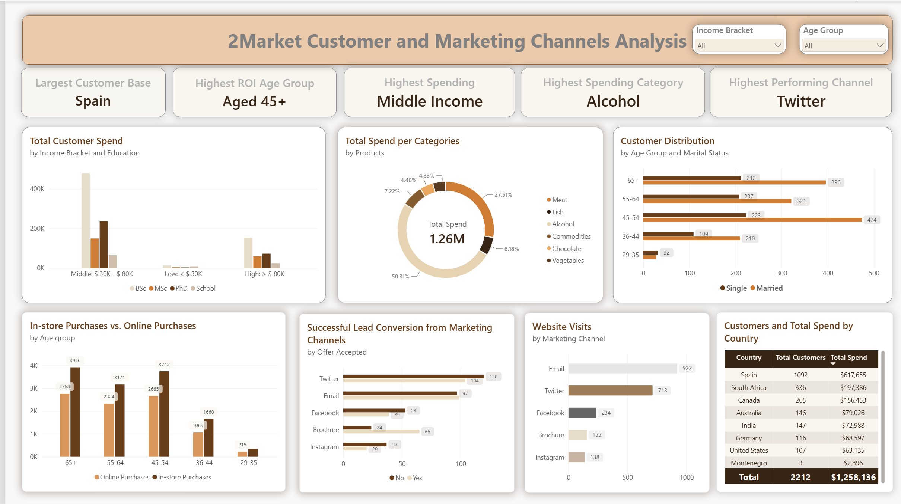

# 2Market: Customer Behaviour and Marketing Channel Analysis

**Tools:** SQL, Excel, Power BI (DAX)
**Case study:** [lanngoc94.github.io/2market.html](https://lanngoc94.github.io/2market.html)

## Business question

2Market, a global retailer, wants to know who its customers are, what they buy and which marketing channels work, so it can spend its marketing budget where it gets the best return.

## Key findings

- **Spend concentration:** $1.26M total spend across 2,212 customers. Spain is the largest market, with 1,092 customers and $618K (49% of all spend), three times South Africa ($197K).
- **Products:** Alcohol accounts for 50% of spend and Meat for 28%, so two categories drive almost four-fifths of revenue.
- **Customers:** middle-income households ($30K to $80K) spend the most. 45 to 54 is the largest age group (697 customers), and customers aged 45+ give the highest return.
- **Channels:** Twitter brings the most conversions (104) and Email drives the most website visits (922, then Twitter with 713). Facebook, Brochure and Instagram trail on both.
- **Purchase behaviour:** in-store purchases exceed online in every age group, for example 3,916 vs 2,768 for customers aged 65+.

**Recommendation:** focus marketing spend on Twitter and Email, target middle-income customers aged 45+ with Alcohol and Meat offers, and deepen retention in Spain before expanding into smaller markets.

## Dashboard

## Approach

1. **SQL:** cleaned the customer, purchase and marketing data, then wrote aggregation and segmentation queries by country, age group, income bracket and channel.
2. **Excel:** initial exploration and validation of the query results.
3. **Power BI:** built an interactive dashboard with DAX measures, KPI cards, and income and age slicers across spend, customer, channel and country views.

## Files

| File | Contents |
|---|---|
| `images/2market-dashboard.png` | Final Power BI dashboard |

---
Lan Ngoc Mau · [Portfolio](https://lanngoc94.github.io) · [LinkedIn](https://www.linkedin.com/in/lan-ngoc-mau-a2000316b/)
