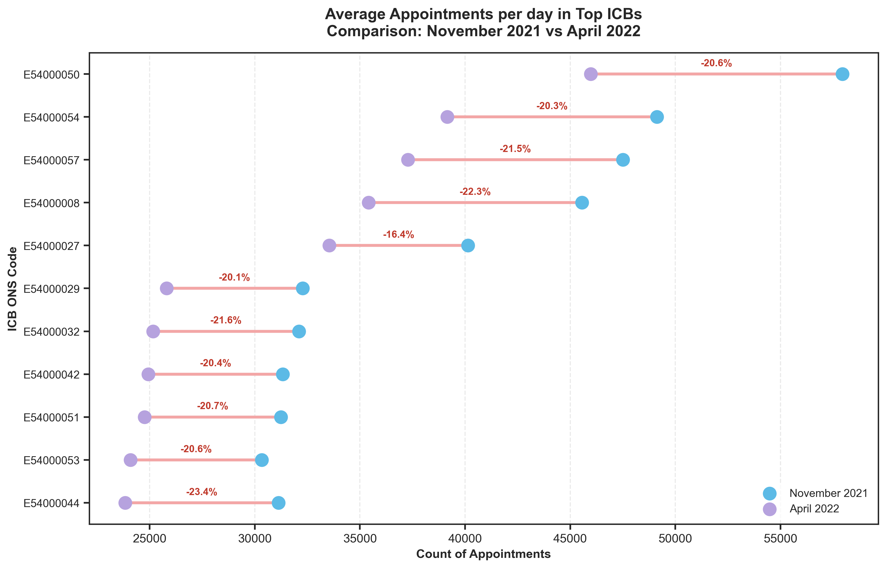
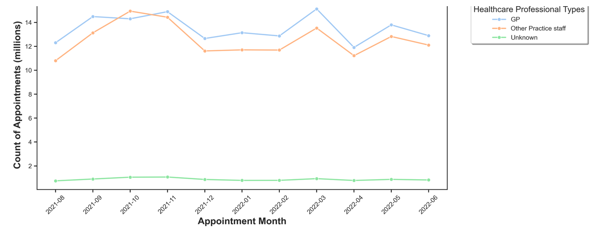
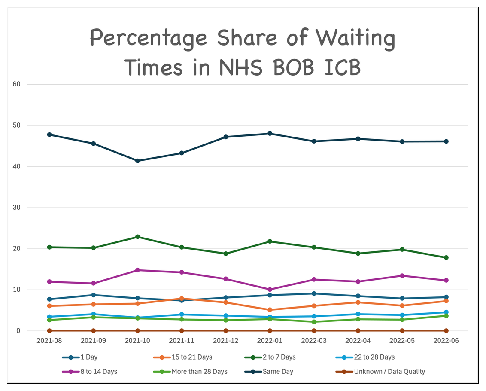

# NHS Appointments: Capacity and Utilisation Analysis

**Tools:** Python (pandas, NumPy, Matplotlib, Seaborn, TextBlob)
**Case study:** [lanngoc94.github.io/nhs.html](https://lanngoc94.github.io/nhs.html)

## Business question

Does the NHS need more staff, or can it make better use of the capacity it already has? Using NHS England GP appointment data (August 2021 to June 2022), I looked for monthly and seasonal patterns, benchmarked the highest-volume Integrated Care Boards (ICBs), and diagnosed why NHS Buckinghamshire, Oxfordshire and Berkshire West (BOB) ICB saw the steepest fall in appointments.

## Key findings

- **Steepest decline:** BOB ICB's appointments fell 23.4% from the November 2021 peak to April 2022, the largest drop among the ten highest-volume ICBs (peers fell 16% to 22%). It sits 4.6% below the national average of appointments per registered patient.
- **Supply, not demand:** GP and other practice staff volumes both fell by 22% to 25%, while the split between staff types barely moved. This points to a capacity cut, not a change in patient behaviour.
- **Stable booking pattern:** same-day appointments stayed at about 46% of the total in every month, so the booking mix did not destabilise.
- **Social media:** the tweet sample was too sparse and mostly unrelated to the NHS to work as an early-warning signal.
- **Data quality:** a large share of appointments is recorded as "Unmapped" or "Inconsistent Mapping", which limits analysis by service type.

**Recommendation:** no extra headcount is needed. Redesign the booking system, close the data-quality gap in service mapping, and use automated reminders to reduce missed appointments. BOB ICB would need about 237 more appointments per 1,000 patients to reach the national average.

## Charts

## Approach

1. Imported and validated three datasets (missing values, data types, date ranges, record counts).
2. Answered descriptive questions: locations, service settings, context types, national categories, busiest months.
3. Built monthly and seasonal trend charts (business days only, UK bank holidays removed) for service settings, context types and national categories.
4. Investigated outliers, such as a spike in planned clinics, by checking whether one ICB drove it and normalising by registered patients.
5. Analysed healthcare-related tweets: hashtag frequency, grouped hashtag categories and TextBlob sentiment.
6. Compared daily utilisation with the NHS planning benchmark of 1.2 million appointments per day, then drilled into BOB ICB by national category, staff type, appointment mode and lead time.

## Files

| File | Contents |
|---|---|
| [`nhs_appointments_analysis.ipynb`](nhs_appointments_analysis.ipynb) | Full analysis as a Jupyter notebook, with all charts and outputs |
| `images/` | Key charts used in the case study |

## Data

The datasets are not included in this repository. The analysis used `actual_duration.csv`, `appointments_regional.csv`, `national_categories.xlsx` and `tweets.csv` (NHS England appointments in general practice data and a tweet sample), plus `gp-reg-pat-prac-all.csv` (NHS Digital registered patients). Place the files in the same folder as the notebook to run it.

---
Completed as part of the LSE Data Analytics Career Accelerator (2026). Lan Ngoc Mau · [Portfolio](https://lanngoc94.github.io) · [LinkedIn](https://www.linkedin.com/in/lan-ngoc-mau-a2000316b/)
