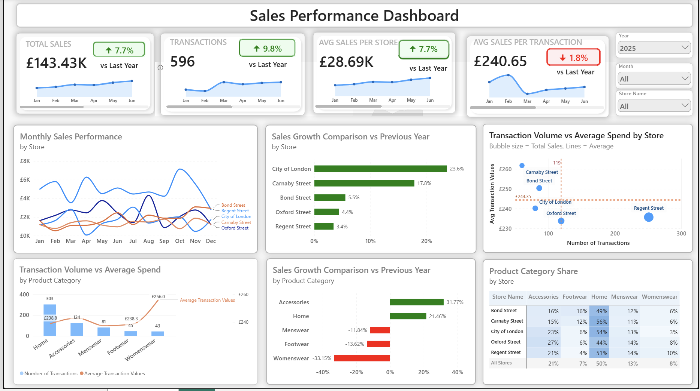

# Retail Sales Performance Dashboard

**Tools:** Power BI, Power Query, DAX
**Case study:** [lanngoc94.github.io/retail-sales.html](https://lanngoc94.github.io/retail-sales.html)

## Business question

A multi-store retailer with five London stores and five product categories needs one view of sales against the previous year: where growth is coming from, and where it is slipping.

## Key findings

- **Overall growth:** total sales reached £143.43K (+7.7% year on year), driven by more transactions (596, +9.8%) rather than bigger baskets, as average spend per transaction dipped 1.8% to £240.65.
- **Stores:** every store grew, led by City of London (+23.6%) and Carnaby Street (+17.8%). Regent Street handles the most transactions but grew the least (+3.4%) at below-average spend.
- **Categories:** Home is about 50% of sales in every store. Accessories (+31.8%) and Home (+21.5%) grew strongly, while Womenswear (−33.2%), Footwear (−13.6%) and Menswear (−11.8%) declined.

**Recommendation:** prioritise recovering Womenswear, which has the highest average transaction value (£256), and use Regent Street's footfall to raise basket size by cross-selling Home and Accessories.

## Dashboard

## How it was built

- **Power Query:** cleaned and shaped the raw sales data for modelling.
- **DAX:** year-on-year growth measures, average sales per store and per transaction, KPI cards with monthly trend lines.
- **Power BI:** year, month and store slicers, a bubble chart with average reference lines, a dual-axis combo chart and a colour-scaled category share matrix.

## Files

| File | Contents |
|---|---|
| `images/sales_dashboard.png` | Dashboard screenshot |

---
Independent project. Lan Ngoc Mau · [Portfolio](https://lanngoc94.github.io) · [LinkedIn](https://www.linkedin.com/in/lan-ngoc-mau-a2000316b/)
