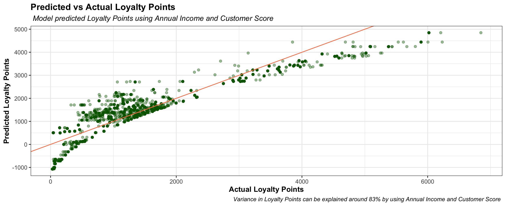
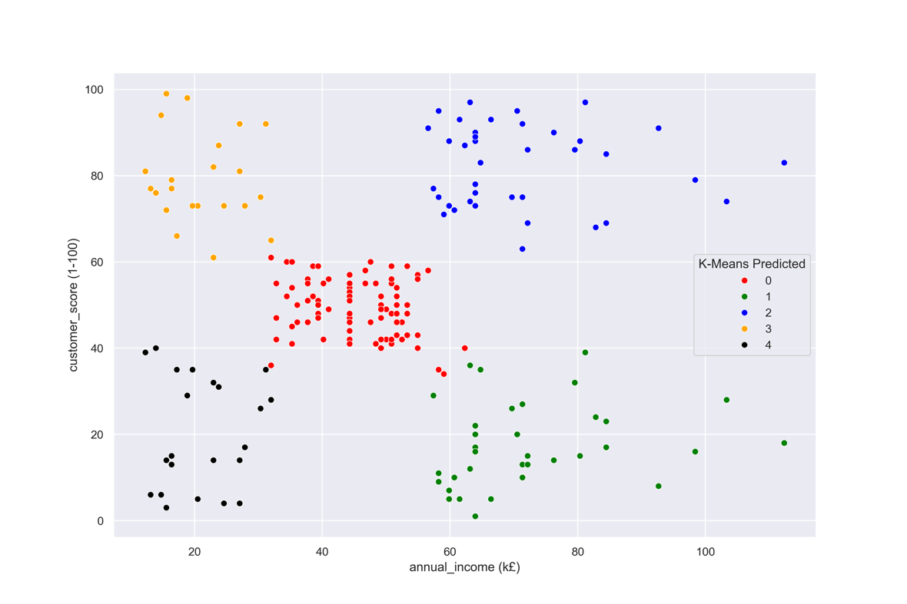
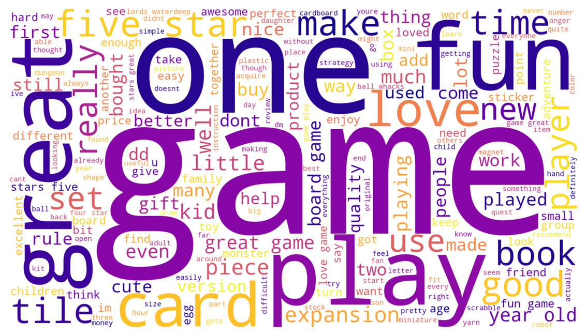

# Turtle Games: Customer Loyalty, Segmentation and Review Sentiment

**Tools:** Python (pandas, statsmodels, scikit-learn, NLTK, TextBlob, VADER, WordCloud), R (tidyverse, ggplot2, plotly, psych, car)
**Case study:** [lanngoc94.github.io/turtle-games.html](https://lanngoc94.github.io/turtle-games.html)

## Business question

Turtle Games, a games manufacturer and retailer, wants to improve sales by understanding its customers. I analysed its customer and review data to answer three questions: how do customers accumulate loyalty points, which customer segments should marketing target, and what do customers say in their reviews?

## Key findings

- **Loyalty drivers:** on their own, spending score explains 45% of the variance in loyalty points and annual income 38%. Together in a multiple linear regression they explain 83% (R² = 0.83). Age, gender and education add almost nothing.
- **Decision tree:** a pruned decision tree regressor (max depth 3) on the same two features reached R² = 0.977 on the test set. Customers with a spending score above 67 earn about 2.5 times the loyalty points of the rest, and those who also earn more than £74k average about 4,850 points.
- **Five customer segments:** k-means clustering (k = 5, chosen with the Elbow and Silhouette methods) split customers by income and spending score, including a high-income, low-engagement group of 330 customers worth targeting.
- **Review sentiment:** 88.8% of reviews were positive (VADER), driven by value for money, fun, gifting and educational use. The main complaints were unclear instructions, wrong age labelling and product quality.
- **Model limits:** the linear model predicts mid-range customers well but gives negative predictions near zero and underestimates customers above about 4,000 points (MAE 415, RMSE 534 against a mean of 1,578).

**Recommendation:** focus loyalty spend on the high-value segment, find out why high-income, low-score customers disengage, and fix the recurring complaints about instructions, age labelling and quality control.

| Segment | Customers | Income | Spending score | Profile |
|---|---|---|---|---|
| 1 | 774 | £40k–£65k | 40–60 | Largest group, moderate spend and engagement |
| 2 | 356 | £55k–£100k+ | 70–97 | High earners who spend and engage heavily |
| 3 | 330 | £55k–£105k+ | 1–40 | Earn well but disengaged, worth a deep dive |
| 4 | 271 | £10k–£35k | 3–40 | Least engaged, lowest spend |
| 5 | 269 | £10k–£35k | 65–99 | Loyal despite low income, value-driven |

## Charts

## Files

| File | Contents |
|---|---|
| `turtle_games_analysis.py` | Python: data cleaning, OLS regression, decision tree (pruning and feature comparison), k-means clustering, NLP with TextBlob and VADER. Exported from a Jupyter notebook (lines starting `# ` were markdown cells) |
| `turtle_games_regression.R` | R: exploratory analysis with ggplot2/plotly, normality checks, multiple linear regression, VIF and model diagnostics |
| `images/` | Key charts used in the case study |

## Data

The dataset (`turtle_reviews.csv`, about 2,000 customers with age, gender, education, income, spending score, loyalty points and review text) was provided for the course and is not included here.

---
Completed as part of the LSE Data Analytics Career Accelerator (2026). Lan Ngoc Mau · [Portfolio](https://lanngoc94.github.io) · [LinkedIn](https://www.linkedin.com/in/lan-ngoc-mau-a2000316b/)
